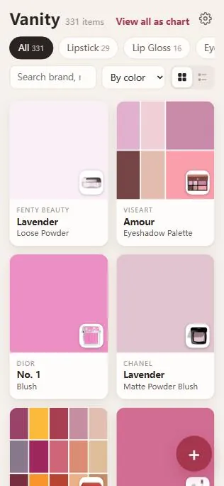
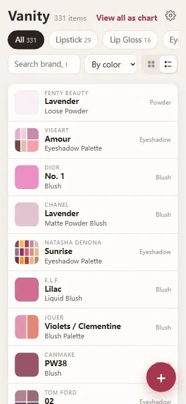
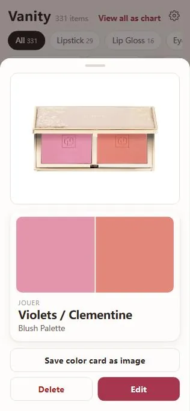
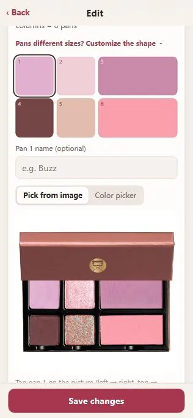
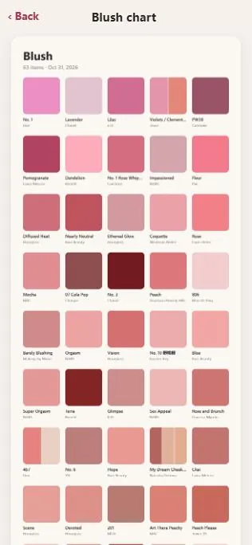

# Vanity — Makeup Organizer

English | [中文](README.zh-CN.md)

A small web app for cataloging makeup. Add an item (brand, product, shade, where you bought it, original and paid price, notes), then pick a picture from an online image search. A color card is generated from the picture automatically, and you can fine-tune it with an eyedropper or color picker. Each category can be viewed as one color chart, and both single cards and charts can be saved as images.

It runs on Cloudflare (Workers + D1 + R2): always on, works anywhere, nothing to start. See [Hosting on Cloudflare](#hosting-on-cloudflare).

> The earlier ASP.NET Core version (`server/`, `start.bat`) is **no longer used or maintained**. See [Legacy PC version](#legacy-pc-version-no-longer-used).

## Screenshots

<table>
  <tr>
    <td align="center"><br><sub>Home: every item as a color card</sub></td>
    <td align="center"><br><sub>Or as a list</sub></td>
    <td align="center"><br><sub>Details: a two-color blush</sub></td>
  </tr>
  <tr>
    <td align="center"><br><sub>Palette layout + eyedropper on the picture</sub></td>
    <td align="center"><br><sub>A category as one color chart</sub></td>
    <td></td>
  </tr>
</table>

## Structure

```
client/                      React + Vite frontend source
worker/                      Cloudflare Worker backend (TypeScript): API + D1 database + R2 pictures
  ├─ migrations/             D1 tables (npm run setup / npm run migrate-db)
  ├─ scripts/                setup, deploy helpers, data migration, backup
  ├─ wrangler.example.toml   Cloudflare config template (committed)
  └─ wrangler.toml           your own copy with your database id (git-ignored, made by npm run setup)
server/MakeupOrganizer.Api   LEGACY ASP.NET Core backend, not used anymore
  └─ wwwroot/                STILL USED: the frontend build output that the Worker serves
backups/                     Cloudflare backups made by `npm run backup` (git-ignored)
docs/screenshots/            Screenshots used in this README
start.bat                    LEGACY: starts the old ASP.NET Core version
```

## How it works

- **Import from screenshots** (+ button): pick one or more order/cart screenshots. Text is read on the device with a free, built-in OCR engine (tesseract.js, no API key), then brand, product, shade, store and prices are guessed from it. Check and fix the rows, uncheck anything that isn't makeup, and save. Missing fields stay empty; add pictures and notes later from each item ("Find a picture & make the color card").
- **Add one item**: fill in the details → **Save & find a picture**.
- On the picture page, **Upload my own photo** if you have one, or tap **Search** (the box is filled in with "brand + product + shade"). Nothing is searched until you tap Search, so a photo of your own costs no Serper credit; a search you already ran is remembered until the app is closed. Tap the picture that matches. The search first searches only the brand's own site, Sephora, Ulta, department stores (Nordstrom, Macy's, Bloomingdale's, Saks, Neiman Marcus) and Temptalia; if that finds fewer than 3 pictures it also searches everywhere (one more Serper credit). **Not here? Search everywhere** does that by hand. Brand sites are listed in `worker/src/sources.ts`.
- The picture is saved to R2 and the color card is generated from its most saturated dominant color. If it's off, drag on the picture to pick the exact spot, or use the color picker.
- Eyeshadow palettes: set rows × columns, then tap each pan on the picture; it moves to the next pan automatically.
- Blush, contour and other non-palette products can have 2–4 colors (side by side, top & bottom, or in quarters): pick one under **Colors** in the color step.
- **Categories & brands** (gear icon on the home page): add, rename, reorder or remove categories (a category can be marked as a palette with a default layout; one in use can't be removed), and keep your own brand list. Your brands and every brand you already own are suggested when typing and recognized in screenshot import. You can also add a category on the spot with **+ New** when adding an item.
- Home shows items as cards or as a list (toggle next to the sort menu). On a phone, swipe left/right on the list to go to the next/previous category.
- **Favorites**: tap the ♡ in an item's details to mark it as something you like (tap again to unmark). The ♡ button next to the search box shows only hearted items, in whichever category is selected; the chip counts and **View all as chart** follow it.
- Item details open as a sheet: swipe left/right (or use ‹ ›) for the next/previous item in the list as shown (same category, search and sort), and swipe down to close it.
- **View all as chart** shows the category as one color chart, sorted by color. From **All**, the chart is split into one section per category; a big collection is split into several images so each can be saved on a phone.
- Clear / colorless products: tick **No color card** in the color step (or in Edit). The product picture is shown instead of a color everywhere (home, details, saved card, chart).
- Search matches the start of words in brand, product, shade and pan names (e.g. `mac` finds MAC but not something bought at Macy's).
- Saving images on iPhone: press and hold the card or chart → **Save to Photos**. On a computer, use **Download**.

### Screenshot import tips

- Crop or zoom so the product rows are large; full-resolution phone screenshots work best.
- A plain list works too (e.g. a Notes screenshot): one product per line or separated by commas, like `mac lipstick ruby woo, ysl lipstick 416`. Brand, product type and shade are split out; headings without a brand or product word are skipped.
- Recognition is English-only. Brands are matched against a built-in list plus your own brands (Categories & brands) and brands you already own.
- Struck-through original prices are hard to read and may come out a little off; double-check them.

## Hosting on Cloudflare

Everything runs on Cloudflare's free tier: the Worker serves the app and the API, **D1** stores items and settings, **R2** stores pictures.

### One-time setup (on your PC, needs Node.js 18+)

1. Create a free account at https://dash.cloudflare.com.
2. In the dashboard open **R2 Object Storage** and click **Get started** once to enable R2 (the free tier includes 10 GB; Cloudflare may ask for a payment method but doesn't charge within the free tier).
3. In a terminal:
   ```
   cd worker
   npm install
   npm --prefix ../client install
   npx wrangler login        # opens the browser to authorize
   npm run setup             # creates the database + bucket, builds and deploys
   ```
   `setup` copies `wrangler.example.toml` to `wrangler.toml` (your own copy, not committed), fills in your database id, and prints the address, e.g. `https://makeup-organizer.<your-subdomain>.workers.dev`.
4. Open the address on your phone and **Add to Home Screen**.

### Image search (Serper)

Online image search uses [Serper.dev](https://serper.dev) (Google Images results). Sign-up is free with no credit card and includes 2,500 free searches. Copy your API key from the Serper dashboard, then:

```
cd worker
npx wrangler secret put SERPER_API_KEY      # paste the key, then Enter
```

Without a key the app still works; you just upload your own photos instead of searching.

### Set a password (do this right away)

```
cd worker
npm run set-password      # type the password you want (hidden), then Enter
```

Opening the app now shows a sign-in page; each phone/browser signs in once and stays signed in for a year. To change the password, run `npm run set-password` again (everyone gets signed out). **Sign out** is at the bottom of Categories & brands.

The pictures, data and image search are all behind the password; only the app icon and manifest (needed for Add to Home Screen) are public.

- If the password secret is ever missing, the app shows a "no password is set" page instead of opening up (only `wrangler dev` on localhost stays open). To run without a password on purpose, set the variable `ALLOW_OPEN=1`.
- 5 wrong passwords from one network, or 30 in total, within 15 minutes locks sign-in until the 15 minutes are up. Phones that are already signed in keep working.

Alternatively you can use Cloudflare Access (email one-time codes): Workers & Pages → makeup-organizer → Settings → Domains & Routes → **Enable Access** next to `workers.dev`. Its free plan may ask for a payment method.

### Updating after code changes

Double-click `worker/deploy.bat`, or:

```
cd worker
npm run deploy
```

`deploy` builds the frontend (into `server/MakeupOrganizer.Api/wwwroot`) and deploys the Worker. Plain `npx wrangler deploy` uploads whatever was built last, so frontend changes only go live after a build. Database tables are created by `npm run setup`; the sign-in lockout table is also created by the Worker itself, so deploying never needs `npm run migrate-db`.

### Your config file: wrangler.toml

`worker/wrangler.toml` holds your own Cloudflare database id, so it is git-ignored; the committed template is `worker/wrangler.example.toml`. `npm run setup` creates `wrangler.toml` from the template for you. If you skip setup (for example to only run it locally), copy it yourself:

```
cd worker
copy wrangler.example.toml wrangler.toml
```

If you change a setting (for example the cleanup schedule under `[triggers]`), change it in both files so the template stays up to date.

### Sharing this repository

The repository only holds code. Your items, categories and pictures live in your own Cloudflare account (D1 + R2), and the Serper key and app password are Cloudflare secrets, so none of them are in git. Someone who clones the repo goes through [One-time setup](#one-time-setup-on-your-pc-needs-nodejs-18) with their own Cloudflare account, Serper key and password, and gets their own empty app. (Screenshots in `docs/screenshots/` are public, though.)

### Notes

- Pictures that were downloaded or uploaded but never saved to an item are cleaned up daily (cron trigger).
- Image search asks Serper for 10 pictures per search: more than 10 is billed as 2 credits.
- `The given account is not valid or is not authorized to access this service [code: 7403]` from a `wrangler d1 …` command (migrate-db, backup) means the wrangler sign-in can deploy Workers but isn't allowed to use D1: run `npx wrangler whoami` to check the account and token permissions, check that no `CLOUDFLARE_API_TOKEN` environment variable with fewer permissions is set, or `npx wrangler logout` and `npx wrangler login` again. Deploying doesn't need D1 access.

## Changing the frontend (requires Node.js 18+)

Run the Worker locally (local database and pictures, no password on localhost), then the Vite dev server in a second terminal:

```
cd worker
copy wrangler.example.toml wrangler.toml                     # first time only, if you haven't run npm run setup
npx wrangler d1 migrations apply makeup-organizer --local    # first time only
npm run dev                                                  # Worker at http://localhost:8787

cd client
npm run dev      # dev server at http://localhost:5173; /api and /images are proxied to the Worker on 8787
```

For image search while testing locally, put `SERPER_API_KEY=your-key` in `worker/.dev.vars` (git-ignored).

`npm run build` in `client/` (or `npm run deploy` in `worker/`) builds into `server/MakeupOrganizer.Api/wwwroot`, which is what the Worker serves.

## Backup

In the `worker` folder run `npm run backup`. It saves `backups/<date>/database.sql` (all items and settings) and `backups/<date>/images/` (every picture an item uses). The first run downloads every picture and takes a while; later runs only download new ones. `backups/` is git-ignored.

To restore the database into a fresh setup: `npx wrangler d1 execute makeup-organizer --remote --file=../backups/<date>/database.sql`, then put each picture back with `npx wrangler r2 object put makeup-organizer-images/<file name> --remote --file=../backups/<date>/images/<file name>`.

## Legacy PC version (no longer used)

The app started as an ASP.NET Core (.NET 8) server in `server/MakeupOrganizer.Api`, run with `start.bat` on the home Wi-Fi, storing data in `server/MakeupOrganizer.Api/data/` (products.json, settings.json, images/) and the Serper key in `appsettings.Local.json`. It has been replaced by the Cloudflare version and is **not used or maintained anymore**; new features (split colors, list view, login protection, backups…) were only checked against the Worker.

What still matters in that folder:

- `server/MakeupOrganizer.Api/wwwroot/` is the frontend build output, served by the Worker (`worker/wrangler.toml`). Don't delete it.
- `npm run migrate-data` (in `worker/`) copied the old local data to Cloudflare. It's only needed if there is still old local data to bring over.
