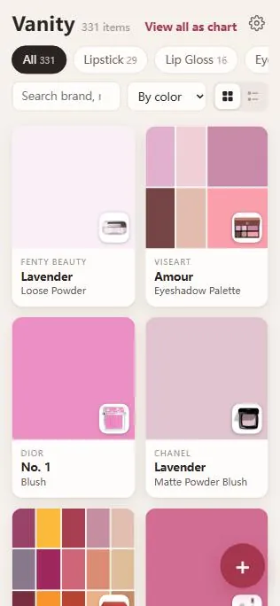
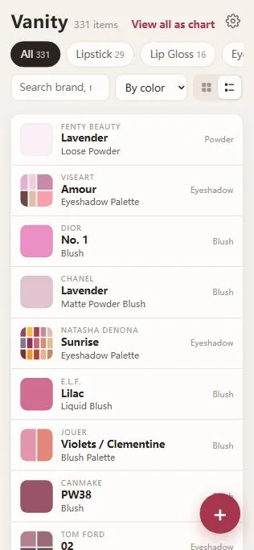
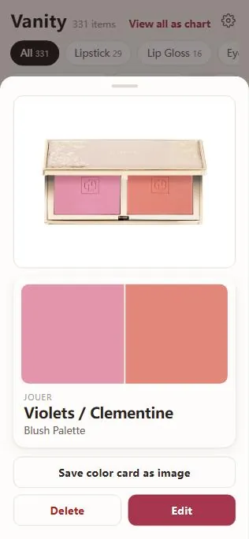
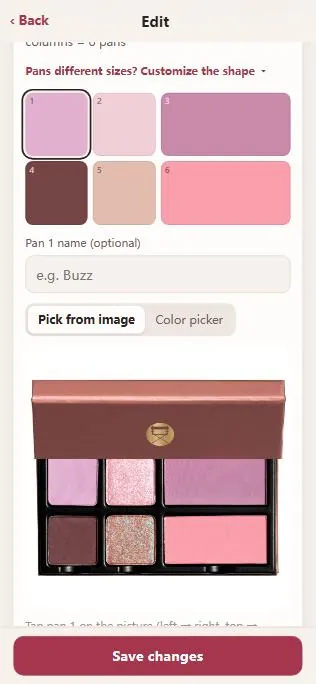
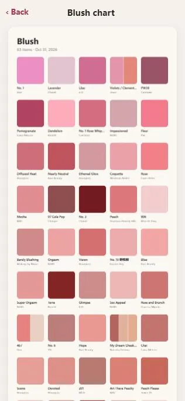

# Vanity — 化妆品整理

[English](README.md) | 中文

一个用来整理化妆品的小网页 App。添加一件产品（品牌、产品名、色号、购买渠道、原价、实付价、备注），然后从网上搜图里挑一张图片。App 会根据图片自动生成色卡，你可以用取色器或调色盘微调。每个分类都能合成一张色卡总表，单张色卡和总表都能存成图片。

App 跑在 Cloudflare 上（Workers + D1 + R2）：一直在线，随时随地能用，不需要手动启动。见 [部署到 Cloudflare](#部署到-cloudflare)。

> 早期的 ASP.NET Core 版本（`server/`、`start.bat`）**已不再使用和维护**。见 [旧版电脑本地版本](#旧版电脑本地版本已停用)。

## 截图

<table>
  <tr>
    <td align="center"><br><sub>首页：每件产品一张色卡</sub></td>
    <td align="center"><br><sub>也可以切换成列表</sub></td>
    <td align="center"><br><sub>详情：一盘双色腮红</sub></td>
  </tr>
  <tr>
    <td align="center"><br><sub>眼影盘排版 + 在图片上取色</sub></td>
    <td align="center"><br><sub>一个分类合成一张色卡总表</sub></td>
    <td></td>
  </tr>
</table>

## 目录结构

```
client/                      React + Vite 前端源码
worker/                      Cloudflare Worker 后端（TypeScript）：API + D1 数据库 + R2 图片
  ├─ migrations/             D1 建表（npm run setup / npm run migrate-db）
  ├─ scripts/                初始化、部署辅助、数据迁移、备份
  ├─ wrangler.example.toml   Cloudflare 配置模板（提交到仓库）
  └─ wrangler.toml           你自己的配置，含你的数据库 ID（不进 git，由 npm run setup 生成）
server/MakeupOrganizer.Api   旧版 ASP.NET Core 后端，已不再使用
  └─ wwwroot/                仍在使用：Worker 提供的前端打包产物
backups/                     npm run backup 生成的 Cloudflare 备份（不进 git）
docs/screenshots/            README 用的截图
start.bat                    旧版：启动以前的 ASP.NET Core 版本
```

## 使用说明

- **从截图导入**（+ 按钮）：选一张或多张订单、购物车截图。文字识别在手机上本地完成，用的是免费的内置 OCR（tesseract.js，不需要 API key），然后自动猜出品牌、产品、色号、购买渠道和价格。核对并修改每一行，把不是化妆品的取消勾选，然后保存。识别不到的字段留空，之后可以在每件产品里补图片和备注（“Find a picture & make the color card”）。
- **添加单件产品**：填好信息 → **Save & find a picture**。
- 在图片页面，如果有自己拍的照片可以点 **Upload my own photo**，或者点 **Search**（搜索框会自动填好“品牌 + 产品 + 色号”）。只有点了 Search 才会搜索，所以用自己的照片不消耗 Serper 额度；搜过的结果在 App 关闭前都会记住。点选对应的图片即可。搜索会先只查品牌官网、Sephora、Ulta、百货公司（Nordstrom、Macy's、Bloomingdale's、Saks、Neiman Marcus）和 Temptalia；如果找到的图片少于 3 张，会再全网搜一次（多用一个 Serper 额度）。**Not here? Search everywhere** 可以手动全网搜。品牌官网列表在 `worker/src/sources.ts`。
- 图片会存到 R2，色卡取自图片里饱和度最高的主色。不准的话，在图片上拖动选准确的位置，或者用调色盘。
- 眼影盘：设置行 × 列，然后在图片上依次点每一格，会自动跳到下一格。
- 腮红、修容等非眼影盘产品可以有 2–4 个颜色（左右、上下或四格）：在取色那一步的 **Colors** 里选。
- **Categories & brands**（首页的齿轮图标）：添加、重命名、排序或删除分类（分类可以设成眼影盘并指定默认排版；正在使用的分类不能删），也可以维护自己的品牌列表。你加的品牌和你已有产品的品牌，会在输入时提示，并在截图导入时被识别。添加产品时也可以用 **+ New** 当场新建分类。
- 首页可以显示成色卡或列表（排序菜单旁边的切换按钮）。在手机上，在列表上左右滑动可以切换到下一个或上一个分类。
- **收藏**：在产品详情里点 ♡ 标记喜欢的产品（再点一次取消）。搜索框旁边的 ♡ 按钮只显示收藏的产品，作用于当前选中的分类；分类旁的数量和 **View all as chart** 也会跟着变。
- 产品详情以弹出面板显示：左右滑动（或点 ‹ ›）切换到列表里的下一件或上一件（同一分类、搜索和排序），向下滑动关闭。
- **View all as chart** 把整个分类合成一张按颜色排序的色卡总表。在 **All** 下，总表按分类分成几段；产品很多时会拆成几张图，方便在手机上保存。
- 透明、无色产品：在取色那一步（或 Edit 里）勾选 **No color card**。这样在所有地方（首页、详情、存的色卡、总表）都会显示产品图片，而不是颜色。
- 搜索匹配品牌、产品名、色号和眼影格名称的单词开头（例如 `mac` 会找到 MAC，但不会找到在 Macy's 买的东西）。
- 在 iPhone 上保存图片：长按色卡或总表 → **存储到“照片”**。在电脑上用 **Download**。

### 截图导入小提示

- 裁剪或放大截图，让产品那几行足够大；手机原尺寸截图效果最好。
- 普通列表也可以（比如备忘录截图）：每行一件，或者用逗号隔开，例如 `mac lipstick ruby woo, ysl lipstick 416`。会自动拆出品牌、产品类型和色号；没有品牌或产品词的标题行会被跳过。
- 只能识别英文。品牌会和内置列表、你自己加的品牌（Categories & brands）以及你已有产品的品牌进行匹配。
- 划线的原价比较难识别，可能有点偏差，请再核对一下。

## 部署到 Cloudflare

全部用 Cloudflare 的免费套餐：Worker 提供 App 和 API，**D1** 存产品和设置，**R2** 存图片。

### 首次设置（在电脑上，需要 Node.js 18+）

1. 在 https://dash.cloudflare.com 注册一个免费账号。
2. 在控制台打开 **R2 Object Storage**，点一次 **Get started** 启用 R2（免费额度 10 GB；Cloudflare 可能要求绑定付款方式，但在免费额度内不收费）。
3. 在终端里运行：
   ```
   cd worker
   npm install
   npm --prefix ../client install
   npx wrangler login        # 打开浏览器授权
   npm run setup             # 创建数据库和存储桶，打包并部署
   ```
   `setup` 会把 `wrangler.example.toml` 复制成 `wrangler.toml`（你自己的那份，不提交），填入你的数据库 ID，并打印出网址，例如 `https://makeup-organizer.<你的子域名>.workers.dev`。
4. 在手机上打开这个网址，然后 **添加到主屏幕**。

### 图片搜索（Serper）

网上搜图用的是 [Serper.dev](https://serper.dev)（Google 图片搜索结果）。免费注册，不需要信用卡，送 2,500 次免费搜索。在 Serper 控制台复制你的 API key，然后：

```
cd worker
npx wrangler secret put SERPER_API_KEY      # 粘贴 key，然后回车
```

没有 key 也能用 App，只是要自己上传照片，不能搜图。

### 设置密码（马上就做）

```
cd worker
npm run set-password      # 输入想要的密码（不显示），然后回车
```

之后打开 App 会先显示登录页；每部手机或每个浏览器登录一次，一年内都保持登录。要改密码，再运行一次 `npm run set-password`（所有设备都会被登出）。**Sign out** 在 Categories & brands 页面的最下面。

图片、资料和搜图都在密码后面；只有 App 图标和 manifest（添加到主屏幕需要）是公开的。

- 如果密码 secret 丢失了，App 会显示 “no password is set” 页面，而不是直接开放（只有在本机运行的 `wrangler dev` 是开放的）。如果确实想不设密码，把变量 `ALLOW_OPEN=1` 设上。
- 15 分钟内，同一个网络输错 5 次密码，或者总共输错 30 次，会锁住登录直到 15 分钟过去。已经登录的手机不受影响。

也可以改用 Cloudflare Access（邮箱一次性验证码）：Workers & Pages → makeup-organizer → Settings → Domains & Routes → 在 `workers.dev` 旁边点 **Enable Access**。它的免费套餐可能要求绑定付款方式。

### 改代码后更新

双击 `worker/deploy.bat`，或者：

```
cd worker
npm run deploy
```

`deploy` 会先打包前端（输出到 `server/MakeupOrganizer.Api/wwwroot`），再部署 Worker。直接运行 `npx wrangler deploy` 只会上传上次打包的结果，所以前端改动要打包后才会生效。数据库表由 `npm run setup` 创建；登录锁定用的表 Worker 也会自己创建，所以部署时不需要运行 `npm run migrate-db`。

### 你的配置文件：wrangler.toml

`worker/wrangler.toml` 里有你自己的 Cloudflare 数据库 ID，所以不进 git；提交到仓库的是模板 `worker/wrangler.example.toml`。`npm run setup` 会自动用模板生成 `wrangler.toml`。如果不跑 setup（比如只想在本地运行），就自己复制一份：

```
cd worker
copy wrangler.example.toml wrangler.toml
```

如果改了设置（比如 `[triggers]` 下的清理时间），两个文件都要改，让模板保持最新。

### 分享这个仓库

仓库里只有代码。你的产品、分类和图片存在你自己的 Cloudflare 账号里（D1 + R2），Serper key 和 App 密码是 Cloudflare 的 secret，所以都不在 git 里。别人 clone 仓库后，用他们自己的 Cloudflare 账号、Serper key 和密码走一遍 [首次设置](#首次设置在电脑上需要-nodejs-18)，就会得到一个属于自己的空白 App。（不过 `docs/screenshots/` 里的截图是公开的。）

### 其他说明

- 下载或上传了但最后没存到任何产品里的图片，每天会自动清理（定时任务）。
- 每次图片搜索向 Serper 要 10 张图：超过 10 张会按 2 个额度计费。
- 如果 `wrangler d1 …` 命令（migrate-db、backup）报 `The given account is not valid or is not authorized to access this service [code: 7403]`，说明 wrangler 的登录能部署 Worker，但没有 D1 的权限：运行 `npx wrangler whoami` 检查账号和 token 权限，确认没有设置权限更少的 `CLOUDFLARE_API_TOKEN` 环境变量，或者 `npx wrangler logout` 后再 `npx wrangler login`。部署本身不需要 D1 权限。

## 修改前端（需要 Node.js 18+）

先在本地运行 Worker（本地数据库和图片，localhost 上不需要密码），再在第二个终端里运行 Vite 开发服务器：

```
cd worker
copy wrangler.example.toml wrangler.toml                     # 仅第一次，如果你没跑过 npm run setup
npx wrangler d1 migrations apply makeup-organizer --local    # 仅第一次
npm run dev                                                  # Worker 在 http://localhost:8787

cd client
npm run dev      # 开发服务器在 http://localhost:5173；/api 和 /images 会转发到 8787 的 Worker
```

本地测试时想用搜图，把 `SERPER_API_KEY=你的key` 写进 `worker/.dev.vars`（不进 git）。

在 `client/` 里运行 `npm run build`（或在 `worker/` 里运行 `npm run deploy`）会打包到 `server/MakeupOrganizer.Api/wwwroot`，也就是 Worker 提供的内容。

## 备份

在 `worker` 文件夹里运行 `npm run backup`。它会保存 `backups/<日期>/database.sql`（所有产品和设置）和 `backups/<日期>/images/`（产品用到的每张图片）。第一次会下载所有图片，需要一些时间；之后只下载新的。`backups/` 不进 git。

恢复到一个全新的部署：`npx wrangler d1 execute makeup-organizer --remote --file=../backups/<日期>/database.sql`，然后用 `npx wrangler r2 object put makeup-organizer-images/<文件名> --remote --file=../backups/<日期>/images/<文件名>` 把每张图片放回去。

## 旧版电脑本地版本（已停用）

这个 App 最早是 `server/MakeupOrganizer.Api` 里的 ASP.NET Core（.NET 8）服务器，在家里 Wi-Fi 下用 `start.bat` 运行，资料存在 `server/MakeupOrganizer.Api/data/`（products.json、settings.json、images/），Serper key 存在 `appsettings.Local.json`。它已经被 Cloudflare 版本取代，**不再使用和维护**；新功能（多色、列表视图、登录保护、备份……）都只在 Worker 版本上验证过。

这个文件夹里仍然有用的：

- `server/MakeupOrganizer.Api/wwwroot/` 是前端打包产物，由 Worker 提供（`worker/wrangler.toml`）。不要删。
- `npm run migrate-data`（在 `worker/` 里）把以前的本地资料复制到了 Cloudflare。只有还有旧的本地资料要搬过去时才需要。
